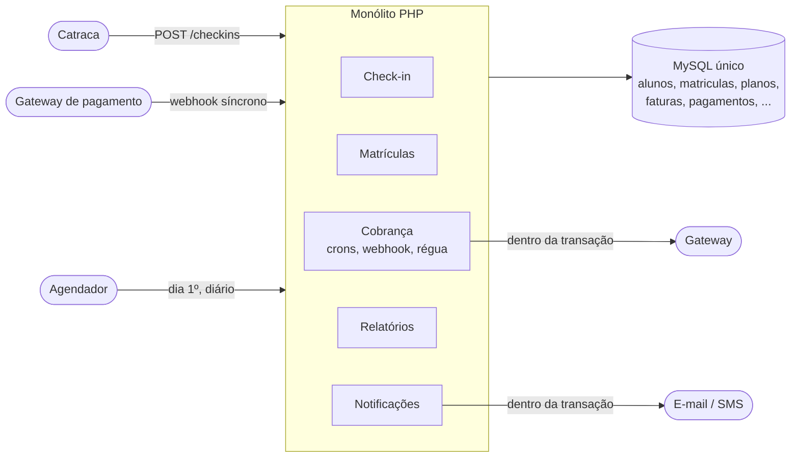
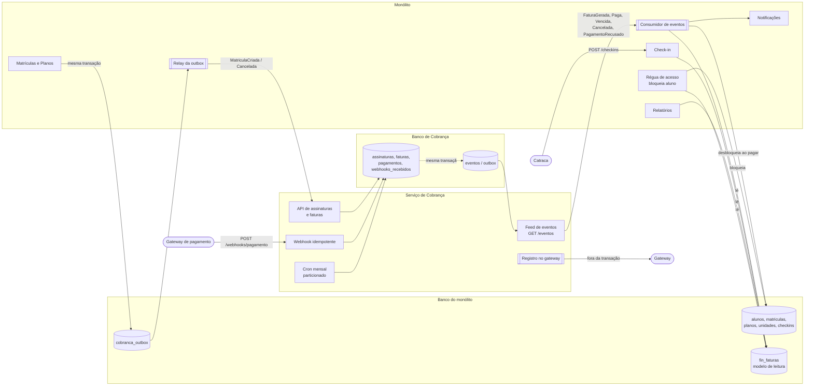
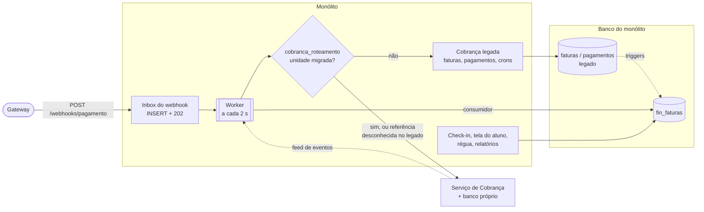

# Arquitetura

Três retratos: antes, durante a transição (o que roda neste repositório) e depois da separação.

## Antes: monólito com Cobrança embutida

Problemas: webhook lento prende o worker da catraca; deploy de qualquer módulo derruba o cron mensal; check-in, relatórios, tela do aluno e régua leem `faturas` direto.

## Depois da separação (estado final)

Regras que o desenho garante:

- **Catraca** só fala com o monólito e só lê o banco local (`fin_faturas`). Cobrança fora do ar não muda a latência (medido: p95 de 99 ms com o serviço parado).
- **Cada serviço só acessa o próprio banco.** A comunicação é por HTTP: comandos do monólito para Cobrança (outbox), fatos de Cobrança para o monólito (feed).
- **Cobrança não decide acesso nem manda mensagem.** Publica fatos; bloqueio, desbloqueio e notificação são do monólito.
- **Gateway fala só com Cobrança.** O registro de cobrança e o webhook são dela.

## Durante a transição (o que este repositório roda)

A diferença para o estado final é que parte das unidades ainda está no legado. A leitura já é única; a escrita é roteada por unidade.

| Acoplamento | Onde era | Como ficou |
|---|---|---|
| A: primeira fatura na transação da matrícula | `MatriculaService::criar` | Unidade migrada: matrícula + `MatriculaCriada` na outbox, na mesma transação; sem gateway nem e-mail dentro dela |
| B: catraca lê `faturas` | `CheckinController` | Lê `fin_faturas` via `SituacaoFinanceira`, para todas as unidades |
| C: webhook escreve em 3 tabelas + SMS síncrono | `PagamentoWebhookController` | Inbox + worker; idempotente; `alunos.situacao` só pelo monólito; serviço com o próprio webhook idempotente |
| D: cron mensal serial | `FaturasGerarMensais` | Legado ignora unidades migradas; no serviço, particionado e com gateway fora do laço |
| E: régua bloqueia lendo `faturas` | `CobrancaRegua` | Continua no monólito (é regra de acesso), lendo `fin_faturas` |
| F: relatórios com JOIN em `faturas` | `RelatorioController` | JOIN em `fin_faturas`, que cobre legado e serviço |
| G: cancelamento mexe em `faturas` | `MatriculaService::cancelar` | Unidade migrada: `MatriculaCancelada` na outbox |
| H: tela do aluno conta faturas | `AlunoController` | Lê `fin_faturas` |

## Containers (docker compose)

| Container | Papel | Porta |
|---|---|---|
| `app` | API do monólito | 8080 |
| `worker` | Inbox do webhook, relay da outbox, consumidor do feed | |
| `cobranca` | API do serviço de Cobrança | 8081 |
| `cobranca-worker` | Registro de faturas no gateway, fora da transação | |
| `setup` | Cria os schemas e popula o seed na primeira subida | |
| `db` | MySQL 8.4 com dois bancos e dois usuários (`estuda_fit_hub`, `cobranca`) | 3316 |
